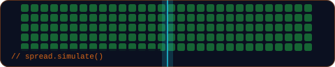
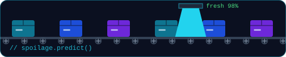

<!-- ============================== 1 · HERO ============================== -->

<picture>
  <source media="(prefers-color-scheme: dark)" srcset="assets/svg/hero-dark.svg">
  
</picture>

   

<!-- ============================== 2 · WHOAMI ============================== -->

AI & Software Engineer and final-year Computer Engineering student (GPA 10.0/10) who builds GenAI agents, computer-vision systems and quantum-secure software, most recently shipping ASP.NET Core + Azure AI services at **Accenture**.
**Open to** AI Engineering and Software Engineering roles and internships. Reach me at [huzaifakamaalkhan@gmail.com](mailto:huzaifakamaalkhan@gmail.com).

<!-- ============================== 3 · EXPERIENCE ============================== -->
## 💼 Experience

| Role | Impact |
|---|---|
| **Accenture**, Pune Software Engineering Intern · May – Jul 2026 | Built enterprise apps with ASP.NET Core, C# and Azure AI; integrated Azure OpenAI-powered backend APIs with CI/CD |
| **IoT Club, JSPM JSCOE** AI Research Intern · Jan – Feb 2026 | Hybrid deep-learning models (VGG16 + ResNet50, CNN-LDA) reaching up to **97.94%** accuracy |
| **Microsoft & SAP** via AICTE / Adverk Technologies AI Intern · Aug 2024 – Mar 2025 | Built an AI Fitness Tracker with TensorFlow and Streamlit at **98%** accuracy |

🎓 **B.E. Computer Engineering**, JSPM's Jayawantrao Sawant College of Engineering, Pune · 2023 – 2027 · GPA **10.0 / 10**

<!-- ============================== 4 · PROOF OF WORK ============================== -->
## 🏆 Proof of Work

Proof → [Quantum Arena repo](https://github.com/HuzaifaKhan-1/Quantum-Arena-1.0---Team-NeuroNix) · [LeetCode](https://leetcode.com/u/Huzaifa_Khan11/) · [CodeChef](https://www.codechef.com/users/huzaifakhan11) <!-- TODO: add certificate / LinkedIn post links for Hero IIC, ISRO BAH, Meta Hacker Cup and Flipkart GRID -->

<!-- ============================== 5 · FEATURED PROJECTS ============================== -->
## 🚀 Featured Projects

<table>
<tr>
<td width="50%" valign="top">

### 🔥 ForeGuard AI
Computer-vision models on satellite imagery (97% accuracy) that predict and simulate forest fires and send real-time SMS/call alerts.

`Python` `TensorFlow` `OpenCV` `FastAPI`

[Repo →](https://github.com/HuzaifaKhan-1/AI-Based-Forest-Fire-Defense-System)
</td>
<td width="50%" valign="top">

### ⚛️ QuMail
Full-stack email client using post-quantum cryptography (Qiskit) for end-to-end encrypted communication.

`Qiskit` `React` `Node.js` `TypeScript`

[Repo →](https://github.com/HuzaifaKhan-1/QuMail---Quantum-Secure-Email-Client-Application) &nbsp; 
</td>
</tr>
<tr>
<td width="50%" valign="top">

### 📦 Smart Warehouse
AI spoilage prediction, shelf-life estimation and warehouse optimisation that cut post-harvest losses by 30%.

`GenAI` `AI Agents` `FastAPI` `MongoDB`

[Repo →](https://github.com/HuzaifaKhan-1/Smart-Warehouse---Nari-Shakti)
</td>
<td width="50%" valign="top">

### 🛒 ProductHub
Layered ASP.NET Core Web API + MVC product platform with JWT auth, search and filters, dashboard analytics and export.

`ASP.NET Core` `C#` `Web API` `JWT`

[Repo →](https://github.com/HuzaifaKhan-1/ProductHub)
</td>
</tr>
</table>

<!-- ============================== 6 · TECH STACK ============================== -->
## 🧠 Tech Stack

<!-- ============================== 7 · ACTIVITY ============================== -->
## 📈 Activity

<!-- The public github-readme-stats instance is shared and can be rate-limited or paused (it returned 503 DEPLOYMENT_PAUSED on 2026-10-30). TODO: self-host on Vercel and swap the host below. -->

<picture>
  <source media="(prefers-color-scheme: dark)" srcset="https://raw.githubusercontent.com/HuzaifaKhan-1/HuzaifaKhan-1/output/snake-dark.svg">
  
</picture>

🐈 <code>./schrodinger.sh</code>

 

